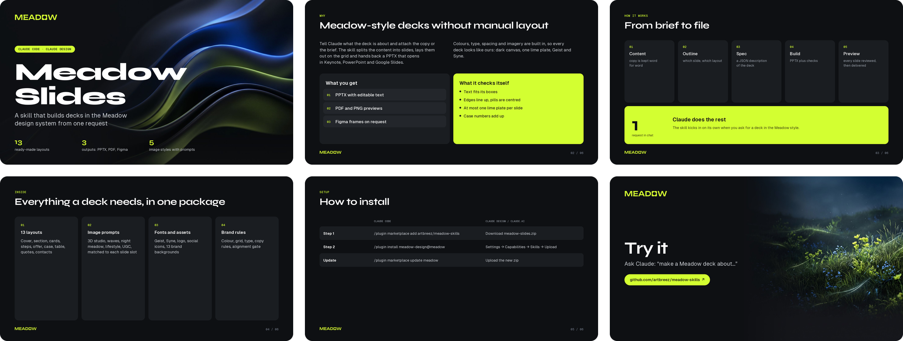

# Meadow skills


Brand skills for Claude, shared across the team. They work in **Claude Code** and in
**Claude Design / claude.ai**.

| skill | what it does |
|---|---|
| `meadow-slides` | Builds decks in the Meadow design system: `.pptx` (and editable Figma frames on request), plus image prompts for covers and backgrounds. Russian and English. |



Just ask in plain words, e.g. *"make a 6-slide client deck about our content factory"*,
*"turn this brief into a Meadow deck"*, *"give me cover image prompts in the Meadow style"*.
Russian works too.

## Install: Claude Code

```
/plugin marketplace add artbreez/meadow-skills
/plugin install meadow-design@meadow
```

Updates: `/plugin marketplace update meadow`. The repo is public, so no GitHub access
or `gh auth` is needed.

Fonts, once per machine (needed to open and edit the decks as designed):
`~/.claude/plugins/…/meadow-slides/scripts/install_fonts.sh`, or install the files in
`plugins/meadow-design/skills/meadow-slides/assets/fonts/` by hand (Geist, Geist Mono, Syne — OFL).

Previews and PDFs are drawn by the script itself (`--png`, `--pdf`), no office app needed.

## Install: Claude Design / claude.ai

1. Download `meadow-slides.zip` from the [latest release](https://github.com/artbreez/meadow-skills/releases/latest)
   (or build it: `./package.sh` → `dist/meadow-slides.zip`).
2. claude.ai → Settings → Capabilities → Skills → **Upload skill** → pick the zip.
   An org admin can upload it once for the whole organization instead.

Re-upload the zip after each update.

## Repo layout

```
.claude-plugin/marketplace.json        marketplace "meadow"
plugins/meadow-design/                 plugin "meadow-design"
  skills/meadow-slides/
    SKILL.md                           instructions Claude follows
    references/                        layouts, design system, image prompts, Figma recipe
    scripts/                           deck engine (python-pptx), preview, Figma renderer
    assets/                            fonts, logo, platform glyphs, backgrounds
    examples/                          sample deck spec
package.sh                             builds the claude.ai zips
```

## Changing the system

Tokens live in one place, at the top of `scripts/meadow_deck.py`, with the rationale in
`references/design-system.md`. Change both, rebuild `examples/sample-deck.json`, look at
the preview, bump the version in `plugin.json` and `marketplace.json`, push.
